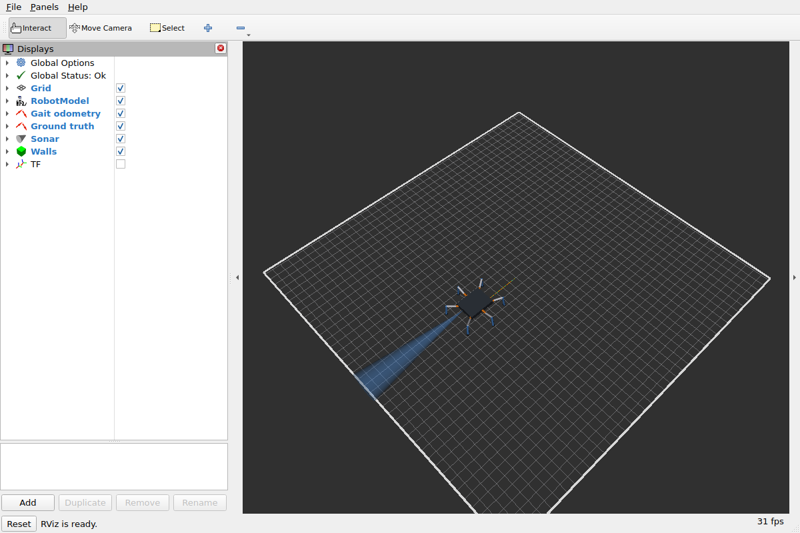
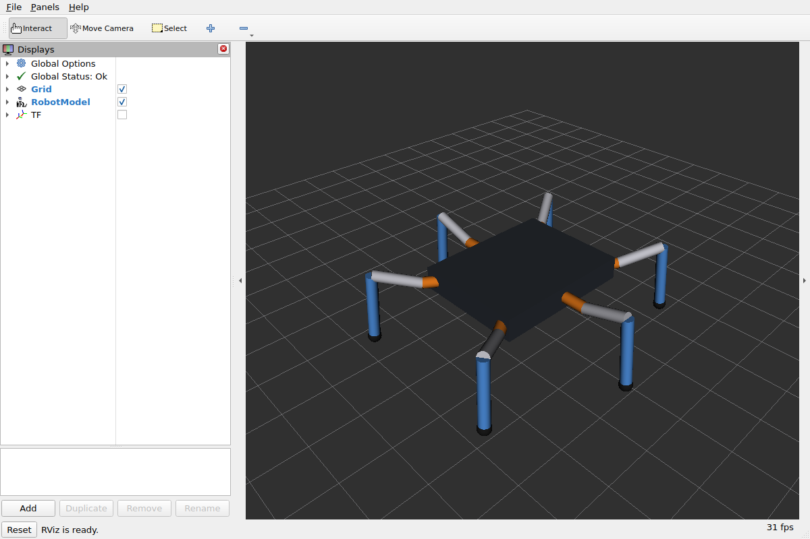
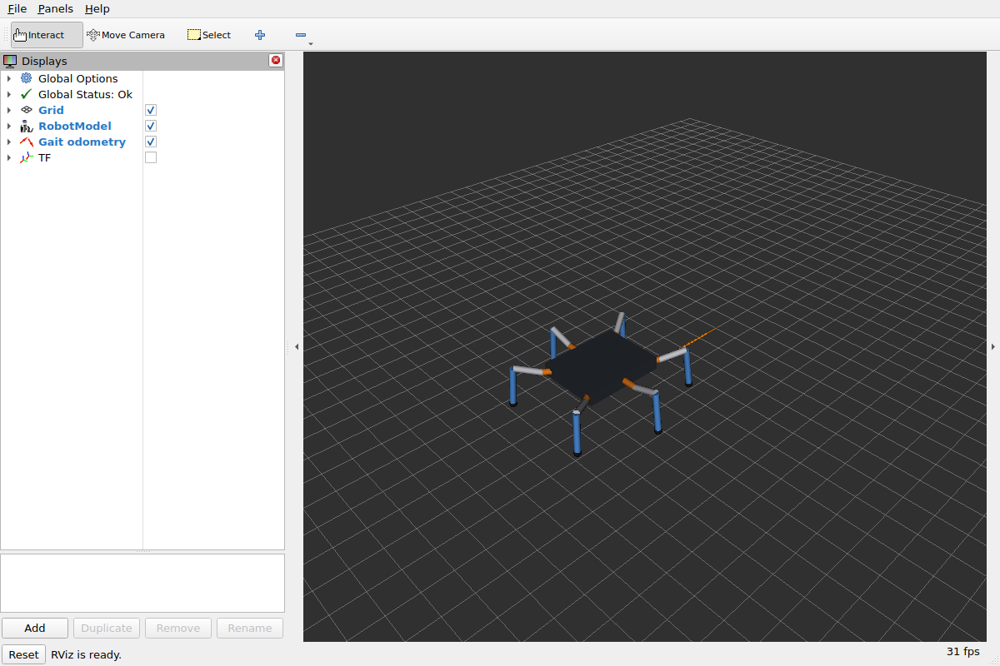

# Simulation

Three ways to run the miniHexa without the robot. All use the firmware's own gait, IK and servo code
(`firmware/lib`), so what walks in simulation is what will walk on the robot:
- the host simulator, scripted scenarios with a pass/fail verdict;
- the same simulator as a ROS 2 node, driven by `/cmd_vel` like the robot;
- the firmware itself in sim mode, on a bare ESP32.

## Host simulator (`sim/`)

```
make -C sim run                          # every scenario, exit 0 on PASS
sim/hexa_sim --slip 0.10 --csv walk.csv  # another slip, a trace per tick
sim/hexa_sim --quad                      # the quadruped crawl (below)
sim/hexa_sim --quad --com -10,0 --set margin=0.015   # centre of mass 10 mm back; a gait override
```

Each 20 ms tick follows the same path as the firmware:
1. The gait gives foot targets.
2. IK turns them into joint angles.
3. The calibration turns the angles into pulses.
4. Each simulated servo turns toward its pulse.

The simulator then works out where the robot really went:
- Forward kinematics of the servos' **actual** angles gives the real foot positions.
- A foot on the ground does not move in the world. The body's true motion is therefore the rigid transform that
  best explains how the grounded feet moved in the body frame (2-D least squares).
- A slip fraction then removes part of that motion.

It also integrates the commanded body motion, exactly as the firmware's `/odom/gait` does, and reports how far
that is from the truth.

The scenarios are: forward, strafe, turn on the spot, arc, and a command beyond the stride limit (which gets
clamped).

A scenario passes when:
- no foot target was out of reach;
- no pulse was clamped;
- the robot stood within two gait cycles of the stop;
- the true travel was 75–105 % of the command.

With no slip, the true motion matches the command within about 1 mm and 1° over 0.3 m and 137°. That shows the
IK, FK and gait are consistent with each other.


A scenario also fails when the centre of mass comes within 5 mm of the edge of the support polygon (the
convex hull of the feet on the ground), or leaves it. The gait is slow enough that static stability is what
counts. The centre of mass is the body's origin unless `--com x_mm,y_mm` moves it. The real one is unmeasured.

### Quadruped crawl (`--quad`)

The middle legs are held up, 40 mm above the stance floor and 60 mm out. The four corner legs step one at a
time: left rear, left front, then right rear, right front (`quad_gait_params()` in `firmware/lib/hexa_gait`).
Three corner feet make a triangle whose long edge runs through the body's centre, so lifting a leg with the
body centred leaves no margin at all. Before each lift the body sways away from that leg until its centre of
mass is `margin` inside the triangle of the feet that stay down. The two sides need opposite sways, so the
sway across happens while all four feet are down: a duty above 0.75 leaves that gap after each side's two
steps. Walking waits for the middle feet: switched from the tripod while standing, they rise first (1.0 s),
and they come down the same way on the switch back.

The defaults come from a sweep in this simulator (2026-11-06):

| parameter | value | why |
|---|---|---|
| duty | 0.88 | a 0.26-cycle four-feet gap for each sway across; at 0.85 the sway arrives late |
| sway speed | 0.12 m/s | with 0.08 the body reached 13 mm of a 20 mm target |
| margin | 20 mm | least margin reached in every scenario: 18.5 mm |
| stride | 45 mm | at 55 mm a strafing foot left its reach, the sway on top of the stride |
| period | 2.5 s (up to 4.0) | top speed 20 mm/s, against the tripod's 57 |

Every scenario passes at a slip of 0.05, 0.10 and 0.20, and so does `mode_switch`: tripod to quadruped
standing, a walk, back to six feet, and a tripod walk. The centre of mass is the open question. 10 mm of
offset that the gait does not know about costs about 5 mm of margin, and 10 mm back with 8 mm to one side
leaves 6.4 mm. Told the offset (`com_x`, `com_y`), the gait keeps 15–18 mm with the centre of mass up to 20 mm
off. So the offset has to be measured on the robot before it walks on four.

### Model figures

| figure | value | basis |
|---|---|---|
| servo rate | 10.5 rad/s | listed HPD-0127 0.05 s/60° at 7.4 V, halved for load. **Unmeasured** |
| servo deadband | 3 µs | a typical hobby micro servo. **Unmeasured** |
| pulse resolution | 1 µs | firmware rounds to whole µs |
| foot slip | 5 % of stance motion (`--slip`) | assumed for hard feet on a smooth floor. **Unmeasured** |
| geometry | coxa 30, femur 50, tibia 75 mm; hips on a 120 × 110 mm layout | **placeholders** sized to the 240 × 234 mm listing |

Each figure gets replaced by a bench measurement once the robot is here. The sim is only as good as these numbers.

The world (servos, foot contact, true pose, slip) is `firmware/lib/hexa_world`: the same model the firmware's sim
mode and the ROS 2 node run. The scenarios are `sim/hexa_sim.cpp`.

## Simulated sensors (`firmware/lib/hexa_sensors`)

The IMU and the ultrasonic, fed by the model's true motion. The firmware's sim mode and the ROS 2 node publish
them; the native tests (`test_sensors`) check them. A simulated sensor behaves like a typical real one and
declares the noise it actually makes: the white noise is uniform on ±peak, so its variance is peak²/3, and that
is the covariance in the message, never a second constant.

**IMU** (`/imu/data`, 50 Hz, frame `imu_link`): the QMI8658A, accelerometer and gyro, no magnetometer. The
orientation is the board's AHRS ([firmware.md](firmware.md#ahrs)), run on these samples: below.

| figure | value | basis |
|---|---|---|
| accel noise | variance 8e-5 (m/s²)² | the QMI8658's datasheet figure (linorobot2-cockpit's per-chip table) |
| gyro noise | variance 2e-6 (rad/s)² | the same table |
| gyro bias | starts at 0 (calibrated at boot), random walk 0.0015 rad/s/√s, held within ±0.004 rad/s | generic MEMS. **Unmeasured** |
| accel bias | random walk 0.01 m/s²/√s, held within ±0.03 m/s² | generic MEMS. **Unmeasured** |
| scale error | +1 % on every axis | generic MEMS. **Unmeasured** |
| band limit | 60 ms | the accelerometer's low-pass |
| mount tilt | roll 1.0°, pitch −1.5° | a board is never mounted level. The URDF's `imu_link` is level, so the stack meets the tilt as an unmodelled error, as on the robot |

Standing still it reads about 9.90 m/s² on z and +0.23 to +0.24 m/s² on x: the tilt leaking gravity (0.26), less
the bias. Turning
0.4 rad/s for 6 s, the integrated gyro is within 2 % of the true turn. Gait odometry claims 6 % more than the
truth: the slip the IMU can see and the gait cannot. Walking, the tripod hand-overs show as ~0.6 m/s² jolts.

**Orientation** (the AHRS on the simulated IMU; `test_ahrs`, and the board check on the bare ESP32). The yaw
column is the AHRS on the raw samples; the board takes the gyro's bias out while it stands
([firmware.md](firmware.md#ahrs)), and then 120 s standing drift 0.0045 rad at worst instead of 0.055:

| | roll and pitch error, rms (worst) | yaw (raw gyro) |
|---|---|---|
| standing 30 s | 0.145° (0.45°) | +0.012 rad: the gyro bias's integral |
| turning 0.4 rad/s, 6 s | 0.160° (0.45°) | 2.289 rad against the true 2.260 (1 % scale error) |
| walking 0.05 m/s, 30 s | 0.150° (0.50°) | +0.012 rad |

The error is measured against the sensor's true tilt, the mount's: the model's body stays level. The declared
(0.2°)² covers it. On the board, standing, the AHRS reads roll +0.9° and pitch −1.35° to −1.4°, the mount less the
accelerometer's bias; a 3 s turn reads within 0.004–0.024 rad of ground truth (the 1 % scale error is 0.011 of
it, the rest the bias's walk since it was learned).

**Ultrasonic** (`/sonar`, 10 Hz, frame `sonar_link`, `sensor_msgs/Range`): a 15° cone, raycast against the
walls of the world: by default a closed 2 m × 2 m room centred on the start pose (`room_half_size` on the
node).

| figure | value | basis |
|---|---|---|
| cone | 15°, 9 rays | HC-SR04 class. **Unmeasured** |
| range | 0.02 – 4.0 m: `-inf` closer, `+inf` beyond (REP 117) | HC-SR04 class |
| noise | ±(3 mm + 0.5 % of range) | **Unmeasured** |
| reflection | a ray meeting a wall more than 30° off its normal reflects away: no echo from that ray | specular, typical of a smooth wall |
| mount | 0.08 m forward of the body centre, 0.08 m up, looking forward | **placeholder**; the URDF's `sonar_link` is the same, checked by a test |

Not modelled: the floor echo, a corner's retro-reflection (a real corner answers even at a steep angle), and the
first echo's dependence on the target's size.



## ROS 2 node (`ros/hexapod_sim`)

The host simulator's world as a ROS 2 node that stands in for the firmware. No board and no agent are needed:

```
ros2 launch hexapod_sim sim.launch.py              # node + walking view in RViz
ros2 launch hexapod_sim sim.launch.py slip:=0.10   # another floor
```

| topic | type | notes |
|---|---|---|
| `/cmd_vel` | `Twist` (Jazzy), `TwistStamped` (Lyrical) | as the firmware is built; parameter `cmd_vel_stamped` overrides |
| `/joint_states` | `sensor_msgs/JointState` | the simulated servos' angles, 25 Hz, best effort |
| `/odom/gait` | `nav_msgs/Odometry` | the gait odometry, exactly as the firmware computes it |
| `/sim/ground_truth` | `nav_msgs/Odometry` | where the body really went (grounded feet, less slip), 5 Hz; `odom` frame, same origin |
| `/imu/data` | `sensor_msgs/Imu` | the simulated QMI8658A, 50 Hz, with the AHRS's orientation (above) |
| `/sonar` | `sensor_msgs/Range` | the simulated ultrasonic, 10 Hz (above) |
| `/sim/walls` | `visualization_msgs/Marker` | the room's walls, latched, for RViz |

All but `/cmd_vel` and `/sim/walls` are best effort, as from the firmware. The node steps the world at the
firmware's 50 Hz frame, and the gait's 0.5 s command timeout applies. Parameters: `slip`, `room_half_size`,
`seed` (sensor noise), `cmd_vel_stamped`.
`sim.launch.py` includes the walking view (below), so the robot is drawn where the EKF says, as on the real
robot. Three trails show the difference: orange for the gait odometry (`/odom/gait`), blue for the EKF (`/odom`),
green for where it really went (`/sim/ground_truth`). The room's walls and the sonar cone are drawn too.

It is tested against the board: the bare-ESP32 sim-mode check passes on the node with the same numbers. Its own
`colcon test` walks it 0.2 m and checks the ground truth against the slip (at slip 0.05 and 0.5), the IMU's
rates, covariances and standing reading, and the sonar's distance to the wall before and after the walk. A second
test runs the EKF on it (below).

## Firmware sim mode

On a bare ESP32 (or the miniHexa before its pins are identified) the `base` application runs the same model:
simulated servos, their angles on `/joint_states`, and the simulated `/imu/data`, `/sonar` and
`/sim/ground_truth`, at the node's rates. A micro-ROS agent on the serial port and a `/cmd_vel` publisher
are enough to watch the gait in RViz (`display.launch.py source:=robot`, below).

## Robot model and RViz (`ros/hexapod_description`)

A ROS 2 package with the miniHexa URDF (xacro), an RViz config and a display launch. Build it in a colcon workspace,
then:

```
ros2 launch hexapod_description display.launch.py                # the gait's standing pose
ros2 launch hexapod_description display.launch.py source:=gui    # a slider per joint
ros2 launch hexapod_description display.launch.py source:=robot  # /joint_states from the firmware
```

- `stand` holds the gait's neutral stance (`config/stand_pose.yaml`).
- `gui` needs `joint_state_publisher_gui`, which not every image has.
- `robot` takes `/joint_states` from the firmware's `base` application, through a micro-ROS agent: sim mode on a
  bare ESP32, or the robot itself. A hand-published `/joint_states` needs a real stamp (`header: {stamp: now}`):
  `robot_state_publisher` publishes nothing for stamp zero.



The fixed frame is `base_footprint`, the floor under the standing body. `base_link` is at hip height.

The URDF is tied to the firmware by tests (`colcon test`):
- **Joint names:** the URDF's are the firmware's 18.
- **Kinematics:** the foot positions agree with the firmware's FK within 0.01 mm, at 300 random poses inside the
  servo range.
- **Limits:** the joint limits are the servo range.
- **Standing pose:** it puts every foot on the gait's neutral stance.

Change a length in `hexa_kin.cpp` without changing it in `minihexa.urdf.xacro` (or the reverse), and the tests fail.

## Walking view (`ros/hexapod_bringup`)

`display.launch.py source:=robot` shows the legs stepping, but the body stays on its grid cell: its fixed frame is
`base_footprint`. To watch the robot walk, run the firmware's micro-ROS agent and:

```
ros2 launch hexapod_bringup view_robot.launch.py
```

- `odom` → `base_footprint` comes from one node (a frame has one parent), chosen by `odom_tf`:
  - `ekf` (the default): robot_localization's EKF (`config/ekf.yaml`, below), filtered odometry on `/odom`.
  - `gait`: `gait_odom_tf` republishes each `/odom/gait` message's pose as the transform, with its own stamp:
    what the gait *commanded*, no slip. For a board without an IMU.
- RViz's fixed frame is `odom`: the robot walks across the grid, with trails of `/odom/gait` (orange) and `/odom`
  (blue) arrows behind it.

A test (`colcon test`) checks that `gait_odom_tf`'s transform carries the message's pose, frames and stamp.

### EKF (`config/ekf.yaml`)

robot_localization's `ekf_node` in 2-D mode, `odom` → `base_footprint`, 50 Hz. It fuses:
- from `/odom/gait`: vx, vy and the yaw rate. The gait walks any direction, so vy is a measurement. Its pose is
  the integral of the same twist and is not fused.
- from `/imu/data`: the yaw rate only. There is no magnetometer, so no absolute yaw exists; roll and pitch do not
  enter a 2-D filter; the linear acceleration (gravity in it, the board tilted) would integrate into a drift.

Walking, the gyro (2e-6) outweighs the gait's yaw rate (0.02), so the heading follows the gyro, not the slipping
feet; position is the gait's alone. Standing, the gait declares its twist exact (1e-8) and the board has taken the
gyro's bias out, so the heading holds. On the sim node (seed 5329, deterministic; the same on Jazzy and Lyrical),
heading error against ground truth:

| | `/odom/gait` | EKF `/odom` |
|---|---|---|
| standing 30 s | 0 | 0.001–0.003 rad |
| walk 0.05 m/s, 4 s | 0.0006 rad | 0.001 rad |
| turn 0.4 rad/s, 3 s (1.13 rad) | 0.067 rad | 0.011 rad |
| arc 0.04 m/s + 0.25 rad/s, 8 s (1.89 rad) | 0.111 rad | 0.044 rad |
| strafe 0.04 m/s, 4 s | 0.001 rad | 0.0001 rad |
| position after all five | 22 mm off | 6 mm off |

The EKF's turn error is mostly the gyro's 1 % scale error and the bias's walk since it was learned; the gait's is
its slip. Its distance is the gait's, slip included (4 s walk: 0.197 m, truth 0.189 m). `colcon test` and the
board check hold these: the TF equals `/odom`, standing drift, the walk's distance, and a turn at least twice as
close to ground truth as `/odom/gait`'s.



## Not yet

- A gyro scale calibration: the 1 % scale error is most of the EKF's turn error.
- A level calibration: the AHRS reports the sensor's tilt, mount included; the board could store the tilt it
  reads standing on a level floor and subtract it.
- Other worlds than the square room (obstacles, a saved map's walls).
- Uneven ground, and body roll and pitch from leg compliance.
